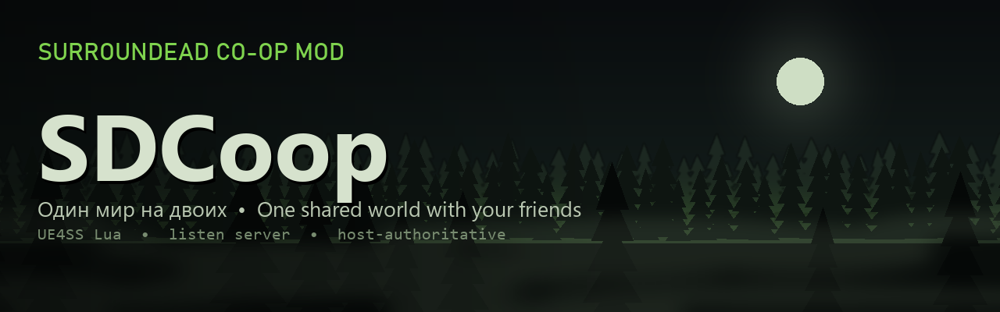

<p align="center">
  
</p>

<h1 align="center">SDCoop — SurrounDead Co-op / Multiplayer Mod</h1>

<p align="center"><b>Co-op for SurrounDead: one shared world for you and your friends</b></p>

<p align="center">
  <a href="../../releases/latest"></a>
  <a href="../../actions/workflows/check.yml"></a>
  
  
  
  
  
  <a href="LICENSE"></a>
</p>

<p align="center">
  <b>English</b> · <a href="README.ru.md">Русский</a>
</p>

<p align="center">
  <a href="../../releases/latest"><b>Download</b></a> ·
  <a href="#installation">Installation</a> ·
  <a href="#how-to-play">How to play</a> ·
  <a href="#what-works">What works</a> ·
  <a href="CHANGELOG.md">Changelog</a> ·
  <a href="docs/CONFIG.md">Settings</a> ·
  <a href="docs/ARCHITECTURE.md">How the code works</a>
</p>

---

An unofficial **co-op multiplayer mod for [SurrounDead](https://store.steampowered.com/app/1645820/SurrounDead/)**, built on [UE4SS](https://github.com/UE4SS-RE/RE-UE4SS): play SurrounDead with friends over the network. One player is the host — their world, their save. The others join them and play in **the very same world**.

It works on the current game version (v0.8.0, Unreal Engine 5.6): the host's world becomes a real Unreal listen server, and the mod syncs everything the single-player game does not replicate — zombies, loot, vehicles, traders, building, saves. Friends join through Steam (Join Game, no IP or VPN) or by IP.

This is a hobby project: it was made to play the game together with a friend. It works, but it is an alpha — expect bugs, and I don't promise long-term support. (The game's name is often searched as "SurroundDead" or "Surrounded".)

<details>
<summary><b>Contents</b></summary>

- [How it differs from other mods](#how-it-differs-from-other-mods)
- [What works](#what-works)
- [Not there yet / known issues](#not-there-yet--known-issues)
- [Plans (no promises)](#plans-no-promises)
- [Installation](#installation)
- [How to play](#how-to-play)
- [Settings](#settings)
- [If something breaks](#if-something-breaks)
- [For developers](#for-developers)
- [License](#license)

</details>

## How it differs from other mods

SurrounDead has no official multiplayer (co-op is only in the developer's plans). I found two other co-op mods (as of November 2026):

| | SDCoop (this mod) | [SurrounSync](https://github.com/SYMPLYSCK/SurrounSync) | [SurrounDeadMP](https://github.com/OiziZ/SurrounDeadMP) |
|---|---|---|---|
| Approach | One shared host world on the engine's own netcode (listen server); the mod syncs what the game does not send over the network | Every player runs their own single-player game; the mod mirrors state between them | A UE4SS installer and a small script that fixes the client spawn; the rest is the game's built-in network mode |
| Joining | Through Steam ("Join Game", no network setup) or by IP: Radmin VPN, ZeroTier, port forwarding | Through Steam, no network setup | By IP |
| Players | Tested by three | Up to four | — |
| Client's character | Lives in the host's world, the host saves it | Their own character from their own world | — |

In short: in SurrounSync everyone plays their own single-player game and the mod carries state between them. SDCoop takes a different approach: it is literally one world. Zombies, vehicles, crates and buildings are the same objects for everyone; one car for two, with a driver and a passenger, shared loot. The price: the single-player game had to be taken apart piece by piece to find which of its functions silently do nothing over the network.

## What works

**Joining and saves**
- The clients' characters follow the host's saves: a world save keeps everyone's state, loading it brings everyone back to it; re-joining the same running world continues where you left. The co-op autosave every 10 minutes really saves.
- The host opens their world with the "Co-op" button in the main menu and loads a save as usual. Friends join through Steam ("Join Game" in the friends list, or the Steam tab in the panel) or by IP.
- The panel shows the player list: who is connecting, loading, in game, and their ping. A corner of the screen shows who is connected, through Steam or by IP, and the ping.
- A player's name comes from the "Name" field on the "Character" tab; if it is empty, from Steam.
- A client creates their character in the game's own character creator.
- The client's character — level, skills, inventory, health, position, discovered map locations — is stored by the host next to the host's save and comes back on the next join.
- In co-op the world autosaves every 10 minutes, even if autosave is off in the game settings.
- Before the world is opened, the mod backs up the host's saves.

**Players**
- Looks, clothes, weapons in hand and on the back, flashlights, lasers, poses and aiming are visible to others.
- Death and respawn: at a respawn point or near the host, death marker, the bag with your items.
- Names and GPS markers of other players, shared markers on the big map (in the player's color), the distraction whistle; a Geiger counter is heard only by its owner.
- A shared map: everyone sees the places any player has discovered; the discovery experience still goes to whoever reaches the place.
- Experience, skills, the skill tree and statistics are per player.
- Game-style notifications to the other players: "Player died" and "Player respawned".

**Combat**
- A client's weapon damage is computed on the host with the stats of their weapon; damage numbers, headshots.
- Grenades, pipe bombs, Molotov cocktails, bottles; grenade launcher, rocket launcher, flare gun and crossbow; camera shake only for those inside the blast.
- Zombies hear every player's shots; hit markers for everyone.
- A kill counts for whoever made it: counter, experience, the popup.

**Zombies and NPCs**
- Zombies look the same on the client as on the host: type, crawlers, bosses, effects of the acid, radiated and grenadier zombies.
- Attacks, staggers, corpses that can be searched and butchered, the enemy health bar.
- Client stealth: crouched, zombies hear them exactly as in single-player.
- Traders: dialogue, the trade window, the trader's money is the same for everyone; a wandering trader stops while someone talks to them.
- Quests are per player, as in single-player: a client takes quests from NPCs, completes them, gets the experience; their quests are saved by the host.

**Items and crafting**
- Inventory, chests, corpses, car trunks (no "blinking" items), crafting, workbenches: dismantling, cooking, camp.
- Medicine, food, water, canteens and jerry cans, the well, water purification, fishing, repair kits, binoculars, night vision.

**World**
- Searched containers (in camps and points of interest too) and loot refills, doors, chopping trees and mining rocks, scrap metal.
- Building and moving furniture; trash, explosive barrels and landmines, infestations and their loot.
- Camps, settlements, random infestations, horde waves, airdrops, plane flyovers and the "blood moon" — from the host, the same for everyone. Camp and player-built turrets: shots, aim, switching off and damage are shared.
- Time of day and weather are shared; so are electricity, switches, doors, keypad locks and scanners in labs and bunkers. Locks are picked with each player's own lockpicks.
- Experience for a destroyed infestation goes to every player nearby, each at their own level.

**Vehicles**
- Driver and passenger, proper poses, the passenger takes the wheel when the driver gets out.
- Refueling and repairs by a client, headlights, horn, color, buying a vehicle from the trader.

**Diagnostics**
- A detailed `UE4SS.log` on both PCs: a state snapshot every 30 seconds, a report of the mod's load, warnings about hitches with their cause.

## Not there yet / known issues

- **Joining through Steam is new**: it has seen less testing than joining by IP. If Steam does not work, IP (Radmin VPN, ZeroTier, forwarding UDP 7777) works as before. A console window flashes for a moment when the game starts — that is the Steam helper starting.
- **No chat.**
- **Two seats per vehicle**: driver and passenger.
- **No "downed" state with reviving a teammate**, no kick and no server password.
- **Load**: UE4SS intercepts the game's calls, which is noticeable on weak PCs. Only a custom UE4SS build can fix that (see plans).
- **Tested by three players.** More players should work in theory, but has not been tested.
- **Fresh fixes** are often verified only by tests without the game — check the logs and report if something is off.
- **Game version**: tested on SurrounDead v0.8.0 (UE 5.6.1). A game update may break something.

## Plans (no promises)

No dates and no guarantees — as time and motivation allow:
- chat;
- a custom UE4SS build with fast hook lookup — less load;
- testing with three or four players;
- maybe a "downed" state with reviving a teammate.

## Installation

**The easiest way is the archive from [Releases](../../releases):** it contains UE4SS and the mod, already set up.

1. Steam → SurrounDead → Manage → Browse local files. The folder `...\steamapps\common\SurrounDead` opens.
2. Extract the archive there, replacing files. You should get `SurrounDead\Binaries\Win64\dwmapi.dll` and the folder `SurrounDead\Binaries\Win64\ue4ss`.
3. Start the game through Steam. If the mod asks you to restart the game once, do it: on the first start it writes the game's network settings (`Engine.ini`).

All players must have the same mod version.

For joining through Steam the archive includes a small helper, `ue4ss\Mods\SDCoop\steamlink\SDCoopSteamLink.exe` (source in `tools/steamlink`). It starts and closes together with the game. If an antivirus removes it, or Windows asks about network access, joining through Steam will not work without it, while joining by IP works as usual.

Do not install it together with other mods that bring their own UE4SS: their installer overwrites `dwmapi.dll` and `mods.txt`, and SDCoop silently stops loading.

Uninstall: delete `dwmapi.dll` and the `ue4ss` folder from `SurrounDead\Binaries\Win64`.

**From source:** you need a UE4SS build that supports UE 5.6 (the mod was tested on v3.0.1 Experimental, build `4fb9b615`). Copy the `mods/SDCoop` folder into `SurrounDead\Binaries\Win64\ue4ss\Mods\` — the `enabled.txt` file enables the mod. The Steam helper is built from `tools/steamlink` with `powershell -ExecutionPolicy Bypass -File tools\steamlink\build.ps1 -Out <game folder>\SurrounDead\Binaries\Win64\ue4ss\Mods\SDCoop\steamlink` (it only needs .NET Framework 4, which comes with Windows).

## How to play

The mod's panel is in English or Russian: "Co-op" → "Settings" → language (by default it follows the game's language).

### Through Steam (easier)

You only need to be Steam friends; no IP, VPN or port forwarding.

1. Both start the game through Steam.
2. Host: main menu → "Co-op" → "Open my world to friends", then load a save or start a new game as usual.
3. Friend: in the Steam friends list, click the host → "Join Game". Or in the game: "Co-op" → the **Steam** tab → "Join" next to the host. The host can also invite: "Invite a friend" on the Steam tab. On the first join the character creator opens.

Only the host's Steam friends can join through Steam (settings `steam_link_friends_only`, `steam_link_allow`).

### By IP

1. Both install [Radmin VPN](https://www.radmin-vpn.com/) (or ZeroTier) and join the same network.
2. The host allows the game's incoming connections in Windows Firewall once. PowerShell as administrator, one line:
   ```powershell
   New-NetFirewallRule -DisplayName "SurrounDead co-op (UDP)" -Direction Inbound -Program "<game folder>\SurrounDead\Binaries\Win64\SurrounDead-Win64-Shipping.exe" -Protocol UDP -Action Allow -Profile Any
   ```
3. Host: main menu → "Co-op" → "Open my world to friends", then load a save or start a new game as usual.
4. Client: main menu → "Co-op" → the "By IP" tab → enter the host's Radmin VPN IP (like `26.x.x.x`), port 7777 → "Join by IP". On the first join the character creator opens.

With UDP port 7777 forwarded on the host's router, the host's external IP works instead of Radmin.

## Settings

The "Co-op" panel (button in the main menu, or F7) → the "Settings" tab: language (English / Russian), the main settings and every feature of the mod by group. Numbers and texts live in `SurrounDead\Binaries\Win64\ue4ss\Mods\SDCoop\config.ini`. The full list is in [docs/CONFIG.md](docs/CONFIG.md) (in Russian; the in-game panel shows every setting in English too); almost every feature of the mod can be switched off on its own.

## If something breaks

Right after the problem, copy `SurrounDead\Binaries\Win64\ue4ss\UE4SS.log` — the next game start overwrites it. Ideally from both PCs. The `[SNAP] head v=…` line shows which mod version was actually running.

[Open an issue](../../issues/new/choose) with the "Bug" template — a description and the logs. The easiest way is from the game itself: the "Co-op" panel (F7) → "Report a bug" opens the form with the mod version already filled in, and the log folder.

## For developers

- [docs/ARCHITECTURE.md](docs/ARCHITECTURE.md) — what lives where, what each module does, the principles.
- `mods/SDCoop/scripts/` — the mod itself: `main.lua` and the `sdc_*.lua` modules. Each module starts with a comment on how the matching part of the game works.
- `tests/` — tests on engine stubs, no game needed. Run: `bash tools/run_tests.sh` (needs Lua 5.4 `lua.exe` and `luac.exe` in `tools/lua54/`).
- `tools/package.ps1` builds the archive for players, `tools/deploy.ps1` copies the scripts into the game.
- [CHANGELOG.md](CHANGELOG.md) — what changed from version to version (in Russian).

## License

[MIT](LICENSE). The mod is not affiliated with the developer of SurrounDead. There are no game files in the repository. Release archives include [UE4SS](https://github.com/UE4SS-RE/RE-UE4SS) — it has its own MIT license, included in the archive (`ue4ss\LICENSE`).
