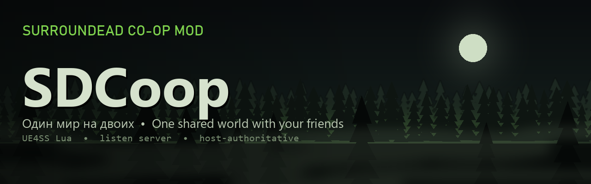

<p align="center">
  
</p>

<h1 align="center">SDCoop — SurrounDead Co-op / Multiplayer Mod</h1>

<p align="center"><b>Кооператив для SurrounDead: один общий мир для тебя и друзей</b></p>

<p align="center">
  <a href="../../releases/latest"></a>
  <a href="../../actions/workflows/check.yml"></a>
  
  
  
  
  
  <a href="LICENSE"></a>
</p>

<p align="center">
  <a href="README.md">English</a> · <b>Русский</b>
</p>

<p align="center">
  <a href="../../releases/latest"><b>Скачать</b></a> ·
  <a href="#установка">Установка</a> ·
  <a href="#как-играть">Как играть</a> ·
  <a href="#что-уже-работает">Что работает</a> ·
  <a href="CHANGELOG.md">Журнал версий</a> ·
  <a href="docs/CONFIG.md">Настройки</a> ·
  <a href="docs/ARCHITECTURE.md">Как устроен код</a>
</p>

---


Неофициальный **кооп-мод (мультиплеер) для SurrounDead** на [UE4SS](https://github.com/UE4SS-RE/RE-UE4SS): играть в SurrounDead вдвоём или с друзьями по сети. Один игрок — хост: его мир, его сохранение. Остальные подключаются к нему и играют в **том же самом мире**.

Это хобби-проект: его делали, чтобы поиграть вдвоём с другом. Работает, но это альфа — баги будут, а долго поддерживать мод я не обещаю.

<details>
<summary><b>Содержание</b></summary>

- [Чем отличается от других модов](#чем-отличается-от-других-модов)
- [Что уже работает](#что-уже-работает)
- [Чего пока нет и что известно](#чего-пока-нет-и-что-известно)
- [Планы (без обещаний)](#планы-без-обещаний)
- [Установка](#установка)
- [Как играть](#как-играть)
- [Настройки](#настройки)
- [Если что-то сломалось](#если-что-то-сломалось)
- [Для разработчиков](#для-разработчиков)
- [Лицензия](#лицензия)

</details>

## Чем отличается от других модов

У SurrounDead нет официального мультиплеера (кооператив есть только в планах разработчика). Других кооп-модов, которые я нашёл, два (на ноябрь 2026):

| | SDCoop (этот мод) | [SurrounSync](https://github.com/SYMPLYSCK/SurrounSync) | [SurrounDeadMP](https://github.com/OiziZ/SurrounDeadMP) |
|---|---|---|---|
| Подход | Один общий мир хоста на сетевом коде самого движка (listen-сервер); мод досинхронизирует то, что игра по сети не передаёт | У каждого игрока своя одиночная игра, мод зеркалит состояние между ними | Установщик UE4SS и небольшой скрипт, который чинит появление клиента; остальное — встроенный сетевой режим игры |
| Подключение | Через Steam («Присоединиться к игре», без настройки сети) или по IP: Radmin VPN, ZeroTier, проброс порта | Через Steam, без настройки сети | По IP |
| Игроков | Проверено втроём | До четырёх | — |
| Персонаж клиента | Живёт в мире хоста, хост его сохраняет | Свой персонаж из своего мира | — |

Коротко: в SurrounSync у каждого своя одиночная игра, а мод переносит между ними состояние. SDCoop — другой подход: здесь это буквально один мир. Зомби, машины, ящики и постройки — одни и те же объекты у всех; машина одна на двоих, с водителем и пассажиром, лут общий. Плата за это — одиночную игру пришлось разбирать по винтику: какие её функции по сети молча не работают.

## Что уже работает

**Подключение и сохранения**
- Персонажи клиентов следуют за сохранениями хоста: сохранение мира фиксирует всех, загрузка возвращает всех к нему; перезаход в тот же запущенный мир — с того же места. Автосохранение кооператива раз в 10 минут действительно сохраняет.
- Хост открывает мир кнопкой «Кооператив» в главном меню и загружает сохранение как обычно. Друзья подключаются через Steam («Присоединиться к игре» в списке друзей или вкладка Steam в панели) или по IP.
- В панели виден список игроков: кто подключается, кто загружается, кто в игре, пинг. В углу экрана — кто подключён, через Steam или по IP, и пинг.
- Кого пускать, решает хост (вкладка «Мир»): всех, по паролю, по одобрению или только приглашённых; предел игроков, кик и бан. Друзей можно пригласить через Steam прямо из панели.
- Экран подключения показывает этапы входа, а если войти не вышло — причину и что делать.
- Хост может притянуть игрока к себе (список игроков → «Ещё»).
- Имя игрока — из поля «Имя» на вкладке «Персонаж», а если оно пустое — имя в Steam.
- Клиент делает персонажа в обычном редакторе персонажа игры.
- Персонаж клиента — уровень, навыки, инвентарь, здоровье, позиция, открытые места на карте — хранится у хоста рядом с его сохранением и возвращается при повторном входе.
- В коопе мир автосохраняется каждые 10 минут, даже если автосохранение в настройках игры выключено.
- Перед открытием мира мод делает резервную копию сохранений хоста.

**Игроки**
- Внешность, одежда, оружие в руках и на спине, фонари, лазеры, позы и прицеливание видны другим.
- Смерть и возрождение: на точке возрождения или рядом с хостом, маркер смерти, сумка с вещами.
- Имена и GPS-метки других игроков, общие метки на большой карте (цветом игрока), свисток-отвлечение, дозиметр слышит только сам игрок.
- Общая карта: каждый видит места, открытые любым игроком; опыт за открытие получает тот, кто дошёл до места сам.
- Опыт, навыки, дерево навыков и статистика — у каждого свои.
- Уведомления в стиле игры: «Игрок погиб» и «Игрок возродился» — остальным игрокам.
- Текстовый чат в стиле игры: Enter открывает строку ввода.
- Нокдаун по желанию (правило хоста, по умолчанию выключено): смертельный удар сажает игрока на землю на 60 секунд, напарник поднимает его, удерживая F.

**Бой**
- Урон оружия клиента считается на хосте с параметрами его оружия; цифры урона, хедшоты.
- Гранаты, самодельные бомбы, коктейли Молотова, бутылки; гранатомёт, ракетомёт, сигнальная ракетница и арбалет; тряска камеры только у тех, кто в зоне взрыва.
- Зомби слышат выстрелы каждого игрока; маркер попадания у каждого.
- Убийство засчитывается тому, кто убил: счётчик, опыт, всплывающее сообщение.
- Огонь по своим по умолчанию выключен (правило хоста на вкладке «Мир»).
- Перезарядка по одному патрону (дробовики, обрез, Winchester, Мосин, револьвер) останавливается на ёмкости оружия при любом пинге.

**Зомби и NPC**
- У клиента зомби выглядят так же, как у хоста: тип, ползуны, боссы, спецэффекты кислотных, радиоактивных и гренадеров.
- Атаки, оглушения, трупы, которые можно обыскать и разделать, полоска здоровья врага.
- Стелс клиента: в приседе зомби слышат его так же, как в одиночной игре.
- Торговцы: диалог, окно торговли, деньги торговца одинаковые у всех; бродячий торговец останавливается, пока с ним говорят.
- Задания у каждого свои, как в одиночной игре: клиент берёт задания у NPC, выполняет их, получает опыт; его задания сохраняются у хоста.

**Предметы и крафт**
- Инвентарь, сундуки, трупы, багажники (без «мигающих» вещей), крафт, верстаки: разборка, готовка, лагерь.
- Медицина, еда, вода, фляги и канистры, колодец, очистка воды, рыбалка, ремкомплекты, бинокль, ПНВ.
- То, что хост выдаёт клиенту (сундуки с добычей, колодец, рыбалка, подобранная постройка, добытый камень), ложится туда, куда его кладёт экран инвентаря самого клиента, а если места нет — под ноги.

**Мир**
- Обысканные контейнеры (и в лагерях, и в точках интереса) и пополнение лута, двери, рубка деревьев и камней, металлолом.
- Постройки и перестановка мебели; мусор, взрывающиеся бочки и мины, гнёзда заражения и их лут.
- Лагеря, поселения, случайные гнёзда заражения, волны орды, авиасбросы, пролёты самолёта и «кровавая луна» — от хоста, одинаковые у всех. Турели лагерей и построенные: выстрелы, наведение, отключение и урон — общие.
- Время суток и погода — общие; генераторы, рычаги, свет, сирены, двери, кодовые замки и сканеры в лабораториях и бункерах — тоже, и их состояние сохраняется вместе с миром. Замки вскрываются отмычками каждого игрока.
- Опыт за уничтоженное гнездо заражения — всем игрокам рядом, каждому по его уровню.
- Метка лагеря на карте (палатки лаборатории, заброшенные лагеря и т. п.) исчезает у всех, как только до лагеря дошёл любой игрок.
- Душ дезактивации: перезарядка, вода и лампочки одинаковые у всех.
- Предупреждения зон (например, о минах у обсерватории) получает каждый игрок, который в зону вошёл.

**Машины**
- До четырёх мест в 4x4, седане, Charger, машине шерифа, SUV и Humvee; в остальных — водитель и пассажир; правильные позы.
- Когда водитель выходит, пассажиры остаются на местах; клавиша G пересаживает за руль или на следующее свободное место. Фары, гудок и переворот — у водителя.
- Заправка и ремонт клиентом, фары, гудок, цвет, покупка машины у торговца.

**Диагностика**
- Подробный `UE4SS.log` на обоих компьютерах: раз в 30 секунд снимок состояния, отчёт о нагрузке мода, предупреждения о зависаниях с причиной.

## Чего пока нет и что известно

- **Подключение через Steam — новое**: проверено меньше, чем подключение по IP. Если через Steam не выходит — по IP (Radmin VPN, ZeroTier, проброс UDP 7777) работает как раньше. При запуске игры на мгновение мелькает окно консоли — это запуск помощника Steam.
- **Задние места в фургонах, грузовиках и пикапах ещё не подогнаны**, поэтому выключены (настройка хоста `vehicle_seats_untuned`); если включить, пассажир может висеть в воздухе или уходить в борт.
- **Нокдаун — новый** и по умолчанию выключен; позы — из самой игры.
- **Нагрузка**: UE4SS перехватывает вызовы игры, и на слабых ПК это заметно. Лечится только своей сборкой UE4SS (см. планы).
- **Проверено втроём.** Больше игроков теоретически возможно, но не проверялось.
- **Свежие исправления** часто проверены только тестами без игры — смотрите логи и пишите, если что-то не так.
- **Версия игры**: проверено на SurrounDead v0.8.0 (UE 5.6.1). Обновление игры может что-нибудь сломать.

## Планы (без обещаний)

Без сроков и гарантий — как будет время и желание:
- своя сборка UE4SS с быстрым поиском перехватов — меньше нагрузки;
- возвращение в игру после короткого обрыва связи без потери места;
- подогнанные задние места в фургонах и грузовиках;
- проверка на троих-четверых.

## Установка

**Проще всего — архив из [Releases](../../releases):** в нём UE4SS и мод, всё уже настроено.

1. Steam → SurrounDead → Управление → Просмотреть локальные файлы. Откроется папка `...\steamapps\common\SurrounDead`.
2. Распакуйте архив туда с заменой. Должны появиться `SurrounDead\Binaries\Win64\dwmapi.dll` и папка `SurrounDead\Binaries\Win64\ue4ss`.
3. Запустите игру через Steam. Если мод попросит перезапустить игру один раз — перезапустите: при первом запуске он записывает сетевые настройки игры (`Engine.ini`).

Версия мода у всех игроков должна быть одинаковой.

Для подключения через Steam в архиве есть маленький помощник `ue4ss\Mods\SDCoop\steamlink\SDCoopSteamLink.exe` (исходники — в `tools/steamlink`). Он запускается вместе с игрой и закрывается вместе с ней. Если антивирус его удалит или Windows спросит про доступ к сети — подключение через Steam без него не заработает, а по IP будет работать как обычно.

Не ставьте вместе с другими модами, которые приносят свой UE4SS: их установщик перезаписывает `dwmapi.dll` и `mods.txt`, и SDCoop молча перестаёт загружаться.

Удаление: удалите `dwmapi.dll` и папку `ue4ss` из `SurrounDead\Binaries\Win64`.

**Из исходников:** нужен UE4SS с поддержкой UE 5.6 (мод проверялся на v3.0.1 Experimental, сборка `4fb9b615`). Скопируйте папку `mods/SDCoop` в `SurrounDead\Binaries\Win64\ue4ss\Mods\` — файл `enabled.txt` включит мод. Помощник для Steam собирается из `tools/steamlink` командой `powershell -ExecutionPolicy Bypass -File tools\steamlink\build.ps1 -Out <папка игры>\SurrounDead\Binaries\Win64\ue4ss\Mods\SDCoop\steamlink` (нужен только .NET Framework 4, он есть в Windows).

## Как играть

### Через Steam (проще)

Нужно только быть друзьями в Steam; IP, VPN и проброс портов не нужны.

1. Оба запускают игру через Steam.
2. Хост: главное меню → «Кооператив» → «Открыть мир для друзей», затем загрузите сохранение или начните новую игру как обычно.
3. Друг: в списке друзей Steam нажмите на хоста → «Присоединиться к игре». Или в игре: «Кооператив» → вкладка **Steam** → «Подключиться» рядом с хостом. Хост может и сам позвать: «Пригласить друга» на вкладке Steam. При первом подключении откроется редактор персонажа.

Через Steam подключаются только друзья хоста в Steam (настройки `steam_link_friends_only`, `steam_link_allow`).

### По IP

1. Оба ставят [Radmin VPN](https://www.radmin-vpn.com/) (или ZeroTier) и заходят в одну сеть.
2. Хосту один раз разрешить игре входящие подключения в брандмауэре Windows. PowerShell от имени администратора, одной строкой:
   ```powershell
   New-NetFirewallRule -DisplayName "SurrounDead co-op (UDP)" -Direction Inbound -Program "<папка игры>\SurrounDead\Binaries\Win64\SurrounDead-Win64-Shipping.exe" -Protocol UDP -Action Allow -Profile Any
   ```
3. Хост: главное меню → «Кооператив» → «Открыть мир для друзей», затем загрузите сохранение или начните новую игру как обычно.
4. Клиент: главное меню → «Кооператив» → вкладка «По IP» → впишите IP хоста из Radmin VPN (вида `26.x.x.x`), порт 7777 → «Подключиться». При первом подключении откроется редактор персонажа.

С пробросом UDP-порта 7777 на роутере хоста вместо Radmin подойдёт внешний IP хоста.

## Настройки

Панель «Кооператив» (кнопка в главном меню или F7) → вкладка «Настройки»: язык (русский / английский), основные настройки и все функции мода по группам. Числа и тексты — в файле `SurrounDead\Binaries\Win64\ue4ss\Mods\SDCoop\config.ini`. Полный список — в [docs/CONFIG.md](docs/CONFIG.md); почти каждую функцию мода можно выключить отдельно.

## Если что-то сломалось

Сразу после проблемы скопируйте `SurrounDead\Binaries\Win64\ue4ss\UE4SS.log` — при следующем запуске игры он перезапишется. Лучше с обоих компьютеров. Строка `[SNAP] head v=…` показывает, какая версия мода реально работала.

[Создайте issue](../../issues/new/choose) по шаблону «Баг» — с описанием и логами. Проще из самой игры: панель «Кооператив» (F7) → «Сообщить об ошибке» откроет форму с уже вписанной версией мода и папку с логом.

## Для разработчиков

- [docs/ARCHITECTURE.md](docs/ARCHITECTURE.md) — что где лежит, что делает каждый модуль, принципы.
- `mods/SDCoop/scripts/` — сам мод: `main.lua` и модули `sdc_*.lua`. В начале каждого модуля — комментарий о том, как устроена соответствующая часть игры.
- `tests/` — тесты на заглушках движка, игра не нужна. Запуск: `bash tools/run_tests.sh` (нужны `lua.exe` и `luac.exe` Lua 5.4 в `tools/lua54/`).
- `tools/package.ps1` собирает архив для игроков, `tools/deploy.ps1` копирует скрипты в игру.
- [CHANGELOG.md](CHANGELOG.md) — что менялось от версии к версии.

## Лицензия

[MIT](LICENSE). Мод не связан с разработчиком SurrounDead. Файлов игры в репозитории нет. В архивах релизов есть [UE4SS](https://github.com/UE4SS-RE/RE-UE4SS) — у него своя лицензия MIT, она лежит в архиве (`ue4ss\LICENSE`).
